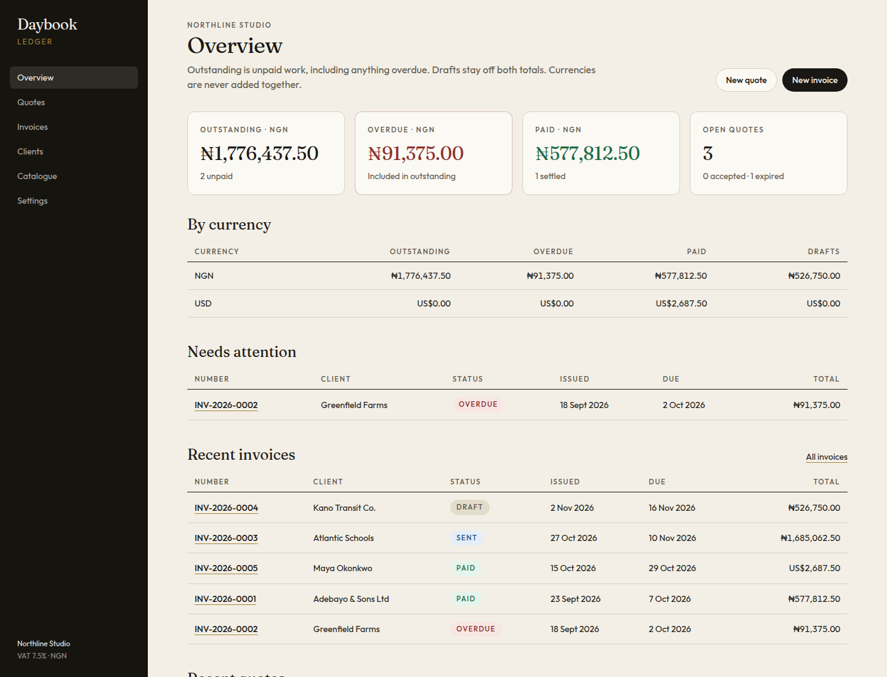
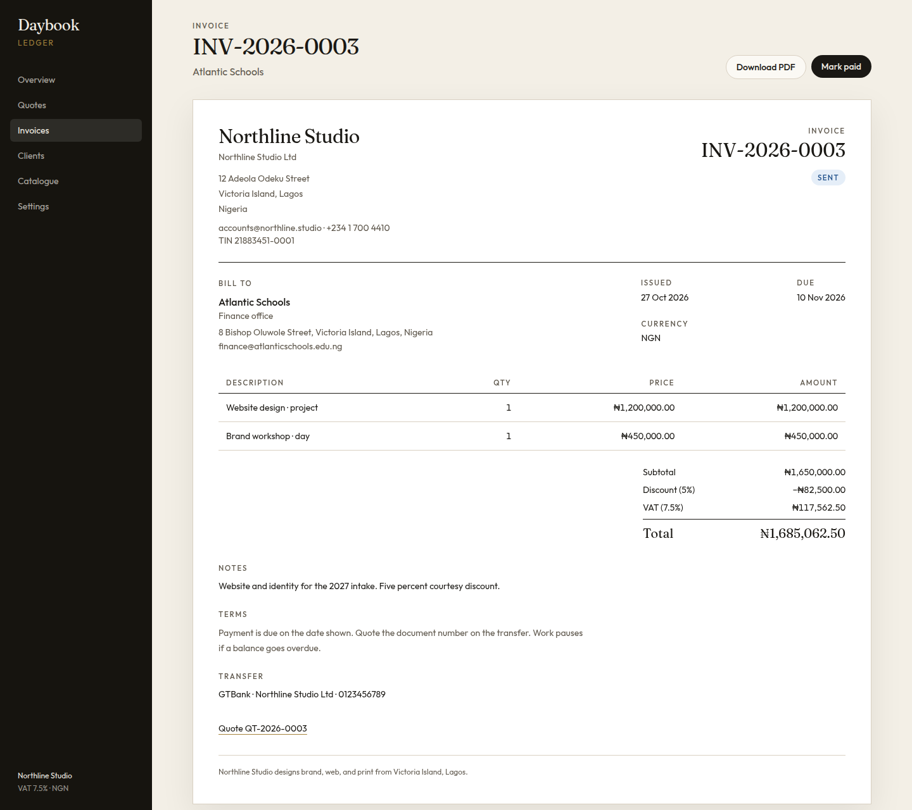
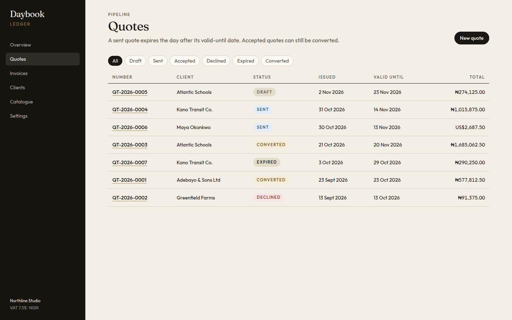
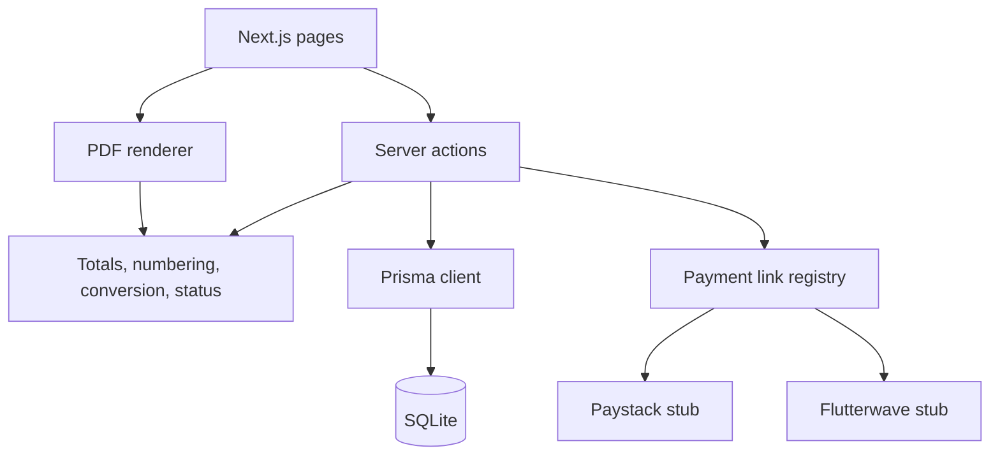

# Daybook

[](https://github.com/maikama8/invoice-quote-generator/actions/workflows/ci.yml)

A quote is not an invoice until someone accepts it, and a naira total is not a dollar total. Daybook keeps those apart: clients, a catalogue, quotes that convert to invoices, VAT, and a PDF that a client can actually pay from.

It is a portfolio project. The database is SQLite, the sample books belong to a fictional Lagos studio, and the Paystack and Flutterwave links are stubs. No payment keys are required.







The screenshots are the seeded books as opened on 2 November 2026. Amounts do not depend on the clock. Dates do: a later seed measures “today” in `APP_TIMEZONE`, so due dates move and a sent invoice can become overdue. Nothing in the pictures was drawn by hand.

## Features

- Clients, and a catalogue of products and services priced in their own currency.
- Quotes with line items, a document discount (percent or fixed), and VAT.
- A quote in draft, sent, or accepted converts to a draft invoice. The quote is then converted, and the lines, discount, currency, and tax rate are copied.
- Invoice statuses: draft, sent, paid, overdue. A sent invoice is overdue the day after its due date. Paid and draft do not move.
- A sent quote expires the day after its valid-until date. An accepted quote can still be converted.
- Multi-currency totals. NGN is first. Currencies are never added together.
- Invoice and quote numbers, `INV-2026-0001` and `QT-2026-0007`, per prefix and year.
- Nigeria VAT at 7.5% by default, stored in basis points, and snapshotted onto each document.
- Business settings: legal name, trading name, TIN, logo, bank details, prefixes, and payment terms.
- A branded PDF for quotes and invoices.
- A payment-link interface with Paystack and Flutterwave stubs. Disabled unless `PAYMENT_LINKS_ENABLED=true` and a provider is selected. The stubs do not call either provider.

## Tech stack

- Node.js 22
- [Next.js](https://nextjs.org/) 16 (App Router), React 19, TypeScript, [Tailwind CSS](https://tailwindcss.com/) 4
- [Prisma](https://www.prisma.io/) 7 with SQLite, through the `better-sqlite3` driver adapter
- [@react-pdf/renderer](https://react-pdf.org/) for PDFs
- [Vitest](https://vitest.dev/) and ESLint
- Docker

## Architecture



Pages read through Prisma and render. Mutations go through server actions, which parse the form and then call the same pure functions the tests call. A document stores the tax rate it was created with, so changing Settings later does not rewrite history.

Money is integer minor units. For these currencies that is kobo or cents: ₦450,000.00 is `45000000`. Quantities are thousandths: 2.5 hours is `2500`. Percentages are basis points: 7.5% is `750`, and 100 basis points is 1%.

## Getting started

Requires Node.js 22.

```bash
git clone https://github.com/maikama8/invoice-quote-generator.git
cd invoice-quote-generator
npm install
cp .env.example .env
npm run db:setup
npm run dev
```

Open `http://127.0.0.1:3000`.

`npm run db:setup` applies the migrations and seeds Northline Studio. The seed does nothing if clients already exist. `make dev`, `make test`, `make lint`, `make build`, and `make setup` wrap the same scripts.

To serve the production build:

```bash
npm run build
npm start
```

### Docker

```bash
docker compose up --build
```

The image listens on port 3000, runs the migrations, and seeds an empty database. The SQLite file is stored in the `daybook-data` volume at `/data/daybook.db`. Payment links stay off.

## Configuration

Settings in the app (tax rate, prefixes, bank, provider) are stored in SQLite. The variables below are process configuration. See `.env.example`.

| Variable | Default | Purpose |
| --- | --- | --- |
| `DATABASE_URL` | `file:./prisma/dev.db` | SQLite file for Prisma and the driver adapter |
| `APP_TIMEZONE` | `Africa/Lagos` | IANA zone for “today”, due dates, and paid dates |
| `PAYMENT_LINKS_ENABLED` | `false` | Must be `true` before a stub link is built |
| `PAYSTACK_PUBLIC_KEY` | empty | Reserved for a live adapter. Stubs ignore it |
| `FLUTTERWAVE_PUBLIC_KEY` | empty | Reserved for a live adapter. Stubs ignore it |

`APP_TIMEZONE` must be an IANA name. The app stops that request if it is not.

An unknown `PAYMENT_LINKS_ENABLED` value is treated as off. The only value that turns links on is `true`.

## How the numbers are computed

**Line amount** = quantity × unit price, rounded half up to the minor unit. A remainder that is exactly half rounds away from zero, so 0.5 kobo becomes 1.

**Subtotal** = the sum of line amounts.

**Percent discount** = subtotal × basis points ÷ 10,000, half up. It cannot exceed 100%. A fixed discount is capped at the subtotal.

**Taxable base** = taxable line amounts, minus their share of the discount. The share is `discount × taxable subtotal ÷ subtotal`, half up. Exempt lines are not taxed. If every line is exempt, tax is zero and the discount still reduces the total.

**VAT** = taxable base × tax rate ÷ 10,000, half up. The default rate is 750 basis points, 7.5%.

**Total** = subtotal − discount + VAT.

Worked example, the Atlantic Schools invoice in the screenshot:

| | NGN |
| --- | ---: |
| Website design | 1,200,000.00 |
| Brand workshop | 450,000.00 |
| Subtotal | 1,650,000.00 |
| Discount 5% | 82,500.00 |
| VAT 7.5% of 1,567,500.00 | 117,562.50 |
| Total | 1,685,062.50 |

A second currency is listed on its own row. Outstanding is sent plus overdue. Overdue is the part of outstanding whose due date is before today. Drafts are in neither figure. The due date itself is still on time.

**Numbers** are `{prefix}-{year}-{sequence}`. The sequence is one higher than the largest existing number with that prefix and year. `INV-2025-0099` does not affect `INV-2026-0001`. A gap is left if a draft is deleted. The width setting only pads; `INV-2026-10000` is not truncated.

**Conversion** copies the client, currency, lines, discount, notes, terms, tax name, and tax rate. The new invoice is a draft, numbered for today, and due after the studio’s payment terms. A declined quote, an expired sent quote, a quote with no lines, and a quote that was already converted are refused. An accepted quote can be converted after its valid-until date.

Deleting a draft invoice that came from a quote sets that quote back to accepted.

## Payment links

`resolvePaymentLink` is the boundary. It returns a disabled result, or a stub URL from the Paystack or Flutterwave gateway. Gateways implement one method, `buildStubLink`. A later live adapter can replace that method. The public key is on the request type so the slot exists, and the stub must not put it on the URL.

With the flag off, or with provider “Disabled”, an invoice explains why there is no link. With both switched on, the link is labelled as a stub and will not take a payment.

## Project structure

```
invoice-quote-generator/
├── prisma/
│   ├── schema.prisma
│   ├── migrations/
│   └── seed.ts                     # Northline Studio
├── src/
│   ├── app/                        # App Router pages and PDF routes
│   ├── components/
│   ├── lib/
│   │   ├── money.ts                # line amounts, discount, VAT, rounding
│   │   ├── numbering.ts
│   │   ├── convert-quote.ts
│   │   ├── status.ts               # overdue, expiry, dashboard buckets
│   │   ├── payments/               # Paystack and Flutterwave stubs
│   │   └── pdf/
│   └── server/                     # Prisma access and server actions
├── tests/
├── docs/images/                    # screenshots in this README
├── Dockerfile
├── docker-compose.yml
└── .env.example
```

## Testing

```bash
npm run lint
npm test
npm run build
```

GitHub Actions (`.github/workflows/ci.yml`) runs those three on Node 22 for pushes to `main` and for pull requests.

The suite covers half-up rounding, 7.5% VAT, a percent discount taken before tax, a fixed discount capped at the subtotal, a mixed taxable and exempt allocation, quantity thousandths, the Atlantic Schools total, document numbers per prefix and year, quote conversion (including expired, declined, and already converted), overdue and expiry, dashboard buckets that do not mix NGN with USD, and payment stubs that stay off by default and do not leak a public key.

## API

### `GET /api/health`

```bash
curl -s http://127.0.0.1:3000/api/health
```

```json
{
  "status": "ok",
  "invoices": 5,
  "quotes": 7,
  "clients": 5
}
```

Those counts are the seed. After that they follow the database.

### `GET /api/invoices/[id]/pdf` and `GET /api/quotes/[id]/pdf`

The branded PDF. Amounts are printed as `NGN 1,685,062.50` because the PDF font has no naira sign. The on-screen ledger uses `₦`.

## Roadmap

- Live Paystack and Flutterwave charges behind the same gateway interface.
- Partial payments and a receipt against an invoice.
- Credit notes.
- Email the PDF.
- Recurring retainers.
- A foreign-exchange table, instead of refusing to mix currencies on one document.
- More than one business on the same database.

## Author

**Abdulrasheed Oseni** ([@maikama8](https://github.com/maikama8)), Zarachtech.

This repository is a public portfolio project.

## License

[MIT](LICENSE). Copyright (c) 2026 Abdulrasheed Oseni.
